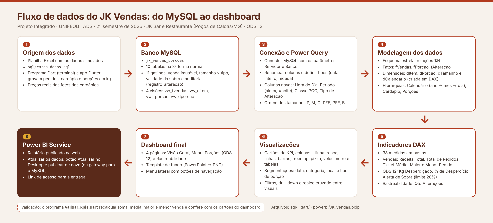

# JK Vendas

Sistema de vendas, cardápio do dia e controle de porções em kg para o **JK Bar e Restaurante** (Poços de Caldas/MG).

Projeto Integrado da UNIFEOB · Análise e Desenvolvimento de Sistemas · 2º semestre de 2026 · Modelagem e Desenvolvimento de Sistemas.

**ODS 12, Consumo e Produção Responsáveis:** o sistema mede a sobra de comida em quilos e avisa quando ela passa de 20%. Arroz e feijão podem ser reaproveitados por até 5 dias (ANVISA, RDC 216/2004); mistura e acompanhamento que sobram viram desperdício.

## Equipe

- João Victor Rodrigues Nussa
- Kauã Marques de Carvalho
- Kauê de Oliveira Silva
- Pedro Joaquim Boletta Piza

## Caminho dos dados

## Pastas

| Pasta | Conteúdo |
| --- | --- |
| `sql/` | Banco MySQL `jk_vendas_porcoes`: 10 tabelas, 11 gatilhos e 4 visões (`jk_vendas.sql`), carga simulada (`carga_dados.sql`) e consultas de conferência. |
| `dart/` | Programa em Dart (terminal) com POO: herança, polimorfismo, abstração, encapsulamento, exceções, interface `Serializavel` (toMap/toJson) e a coleção `CatalogoDeItens`. 34 testes. |
| `pi_app/` | Aplicativo Flutter (macOS/Windows): área do cliente e área da dona. Usa as classes da pasta `dart`. |
| `powerbi/` | Dashboard `JK_Vendas.pbip`: conexão com o MySQL, Power Query, modelo estrela, 38 medidas DAX, 4 páginas com template de fundo, segmentações, hierarquias e drill-down. |
| `docs/` | Template visual do dashboard (PowerPoint e imagens) e o diagrama do fluxo de dados. |

## Como rodar

1. **Banco:** no MySQL Workbench (MySQL 8), rode `sql/jk_vendas.sql` e depois `sql/carga_dados.sql`.
2. **Programa em Dart:** dentro de `dart/`, rode `dart pub get` e `dart run`. Ele pede o usuário e a senha do MySQL (a senha não fica no código).
   - `dart test`: testes das regras, sem precisar do banco.
   - `dart run bin/validar_kpis.dart`: confere soma, média, maior e menor venda com os KPIs do dashboard.
   - `dart run bin/poo_avancada.dart`: demonstração de herança, coleções e JSON, sem banco.
3. **Aplicativo:** dentro de `pi_app/`, rode `flutter run -d macos` (ou `-d windows`).
4. **Dashboard:** no Power BI Desktop (Windows), abra `powerbi/JK_Vendas.pbip`, confira os parâmetros Servidor e Banco e clique em Atualizar.

## Origem dos dados

- **Reais:** os pratos e os preços das marmitas, tirados das fotos dos cardápios do restaurante.
- **Simulados:** vendas, porções preparadas e sobras.
- **Valor de teste:** bebidas, executivos e carne moída (coluna `confirmar`).
