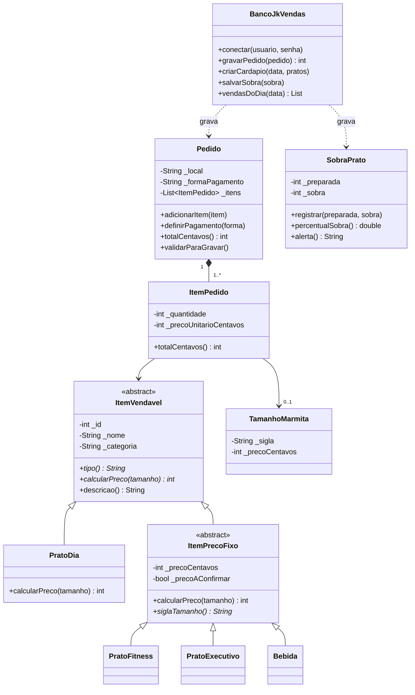
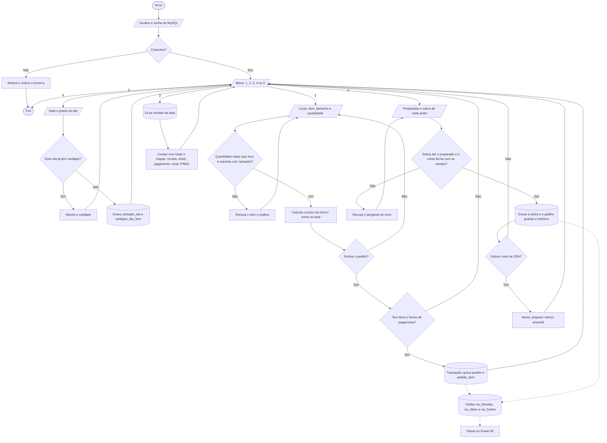

# JK Vendas: programa em Dart

Programa de terminal do JK Bar e Restaurante. Ele monta o cardápio do dia, registra os pedidos, mostra as vendas do dia e registra a sobra de comida. Tudo fica gravado no banco MySQL `jk_vendas`, que alimenta o painel do Power BI.

Para estudar o código arquivo por arquivo, com as perguntas que o professor pode fazer, veja [docs/explicacao_codigo_dart.md](../docs/explicacao_codigo_dart.md).

## Como rodar

Antes, o banco precisa estar criado: rode `sql/jk_vendas.sql` e `sql/carga_dados.sql` no MySQL Workbench. Depois, no terminal, dentro da pasta `dart`:

```bash
dart pub get
dart run
```

- O programa pede o **usuário** (Enter usa `root`) e a **senha** do MySQL. A senha não aparece na tela e não fica gravada em nenhum arquivo.
- O ideal é usar o usuário `jk_app`, que só tem as permissões que o programa precisa (veja a seção Segurança em `docs/modelagem_banco.md`).
- O programa procura o MySQL em `127.0.0.1`, na porta `3306`. Se o seu for diferente, use as variáveis `JK_DB_HOST` e `JK_DB_PORTA`. Exemplo no PowerShell: `$env:JK_DB_PORTA="3307"; dart run`. No macOS ou Linux: `JK_DB_PORTA=3307 dart run`.
- Testes das regras, sem precisar do banco: `dart test` (23 testes).
- O banco guarda o preço em reais (`DECIMAL`); o programa faz as contas em centavos (`int`) e converte na hora de ler e gravar. Na coluna `tamanho` do pedido vai P, M ou G (marmita), PFE (executivo), PFF (fitness) ou B (bebida).
- O aplicativo com telas (Flutter) fica em `../pi_app` e usa estas mesmas classes.
- No Windows, se os acentos aparecerem errados no terminal, rode `chcp 65001` antes do `dart run`.

## O menu

| Opção | O que faz | Tabelas usadas |
| --- | --- | --- |
| 1. Novo pedido | Escolhe o local, os itens (marmita com tamanho, fitness, executivo ou bebida), a quantidade e o pagamento. Grava o pedido inteiro de uma vez. | `pedido`, `pedido_item` |
| 2. Ver as vendas do dia | Para uma data (Enter = hoje), mostra pedidos, receita, ticket médio, receita por pagamento, pedidos por local, marmitas P/M/G e o item mais vendido. | lê `pedido`, `pedido_item`, `vw_ditem` |
| 3. Registrar a sobra | Para cada prato do cardápio, pede as porções preparadas e as que sobraram, confere a conta e avisa quando sobra demais. | `cardapio_dia_item` (o gatilho grava `registro_alteracao`) |
| 4. Montar o cardápio do dia | Escolhe os pratos do dia de uma data. Sem cardápio, o dia não tem marmita para vender. | `cardapio_dia`, `cardapio_dia_item` |
| 5. Exportar o catálogo em JSON | Lê todos os itens, monta a coleção `CatalogoDeItens` e grava `catalogo_jk_vendas.json`. | lê `item` |
| 0. Sair | Fecha a conexão e encerra. | |

Para a demonstração (passo 7 do guia), siga a ordem de um dia de trabalho:

1. Opção 4: montar o cardápio de hoje.
2. Opção 1: registrar um pedido.
3. Opção 2: ver as vendas do dia.
4. Opção 3: registrar a sobra.
5. Conferir no Workbench e clicar em Atualizar no Power BI.

## Arquivos

| Arquivo | Responsabilidade |
| --- | --- |
| `bin/jk_vendas.dart` | Começo do programa: conexão e menu com `do-while`. |
| `bin/validar_kpis.dart` | Atividade de 03/11: soma, média, maior e menor venda conferidas com os KPIs do dashboard (`dart run bin/validar_kpis.dart`). |
| `bin/poo_avancada.dart` | Demonstração da atividade de 17/11, sem precisar do banco: `dart run bin/poo_avancada.dart`. |
| `lib/item_vendavel.dart` | `ItemVendavel` (abstrata) e as filhas `PratoDia`, `ItemPrecoFixo`, `PratoFitness`, `PratoExecutivo` e `Bebida`. |
| `lib/serializavel.dart` | Interface `Serializavel` (toMap/toJson) e o mixin `ConverteJson`, que escreve o toJson uma vez só. |
| `lib/catalogo_de_itens.dart` | `CatalogoDeItens`: coleção de itens (adicionar, remover, buscar, filtrar por classe, ordenar, agrupar) e conversão para JSON e de volta. |
| `lib/tamanho_marmita.dart` | Tamanho da marmita (P, M ou G) e o preço. Executivo, fitness e bebida gravam PFE, PFF e B, que vêm da própria classe (`siglaTamanho`). |
| `lib/item_pedido.dart` | Uma linha do pedido: item, tamanho, quantidade e preço da hora. |
| `lib/pedido.dart` | O pedido: local, pagamento, itens e total. |
| `lib/sobra_prato.dart` | Regras e alertas da sobra de cada prato. |
| `lib/resumo_vendas.dart` | Contas das vendas do dia com listas, conjuntos e mapas. |
| `lib/banco_jk_vendas.dart` | A única classe que fala com o MySQL. |
| `lib/telas.dart` | Uma função para cada opção do menu. |
| `lib/teclado.dart` | Leitura do teclado (texto, número, opção, data e senha). |
| `lib/formato.dart` | Dinheiro, datas e percentual no formato do Brasil. |
| `test/regras_test.dart` | Testes das regras de negócio. |

## Orientação a objetos: onde está cada conceito

| Conceito | Onde aparece |
| --- | --- |
| **Abstração** | `ItemVendavel` e `ItemPrecoFixo` são abstratas: não viram objeto sozinhas. `tipo` e `calcularPreco` não têm corpo na mãe; cada filha é obrigada a escrever o seu. |
| **Herança** | `PratoDia` herda de `ItemVendavel`. `PratoFitness`, `PratoExecutivo` e `Bebida` herdam de `ItemPrecoFixo`, que herda de `ItemVendavel`. O id, o nome e a validação do nome ficam escritos uma vez só, na mãe. |
| **Polimorfismo** | `ItemPedido` chama `item.calcularPreco(tamanho)` sem saber o tipo do item. O prato do dia devolve o preço da marmita, e os outros devolvem o próprio preço. Cada filha de `ItemPrecoFixo` também diz a sua sigla de tamanho (`siglaTamanho`): PFE, PFF ou B. |
| **Encapsulamento** | Os atributos começam com `_` (privados) e são lidos por getters. Os construtores recusam dados errados. `Pedido.itens` devolve uma lista só de leitura: item novo só entra por `adicionarItem`. |
| **Exceções** | `ArgumentError` para valor errado: quantidade zero, sobra maior que o preparado, local inválido. `StateError` para momento errado: marmita sem tamanho, pedido sem itens ou sem pagamento, banco desconectado. `FimDaEntrada` é uma exceção criada pelo projeto. O menu e as telas usam `try`/`catch` para mostrar o motivo e continuar rodando. |
| **Negócio separado do banco** | Só `banco_jk_vendas.dart` tem SQL. As classes do negócio não sabem que o MySQL existe e podem ser testadas sem ele (`dart test`). |



## Fluxograma: o caminho dos dados

Mostra onde os dados entram (teclado), as decisões do sistema, onde são gravados (MySQL) e onde saem (tela e Power BI).



## Decisões da lógica

- **As regras ficam nas classes, não no menu.** Assim, a regra vale em qualquer lugar que use a classe. Por exemplo, um `ItemPedido` com quantidade zero não existe, venha de onde vier.
- **O preço é calculado quando o item entra no pedido** e fica guardado na linha. É o "preço da hora": se o restaurante mudar o preço depois, a venda antiga não muda (igual no banco).
- **Gravação em transação.** O pedido e os seus itens, e o cardápio e os seus pratos, são gravados juntos: se algo falhar no meio, nada fica pela metade.
- **Sobra com decisão.** O sistema confere se a conta fecha (preparada menos sobra precisa cobrir o que foi vendido). Ele também avisa quando o prato acabou e quando sobrou mais de 20%. Esse limite está na constante `SobraPrato.limiteSobraAlta` e pode ser ajustado com o restaurante. É a parte do projeto ligada à ODS 12 (menos desperdício de comida).
- **As contas do dia são feitas em Dart.** O banco só entrega as linhas vendidas. A classe `ResumoVendas` soma com repetição e agrupa com `Set` e `Map`, como pede a unidade de Lógica de Programação.
- **Segurança.** A senha é digitada na hora e não vai para o código nem para o GitHub. Os valores entram no SQL por parâmetros (`:nome`), o que impede injeção de comandos pelo teclado.

## POO avançada: herança, coleções de objetos e refatoração (atividade de 17/11/2026)

Para ver funcionando sem o banco: `dart run bin/poo_avancada.dart`. Os testes novos estão no grupo "Herança, coleções e JSON (17/11)" de `test/regras_test.dart` (`dart test`, 34 testes).

| Pedido da atividade | Onde está |
| --- | --- |
| **Interface** | `Serializavel` (`lib/serializavel.dart`): contrato com `toMap()` e `toJson()`. |
| **Reutilização por mixin** | `ConverteJson` implementa a interface e escreve o `toJson` uma vez só; cada classe só escreve o seu `toMap`. |
| **Reutilização por herança** | `ItemVendavel.toMap()` tem os campos comuns (id, nome, categoria, tipo); `PratoDia` e `ItemPrecoFixo` chamam `super.toMap()` e acrescentam os seus. Fitness, executivo e bebida herdam tudo sem escrever nada. |
| **toMap / toJson** | Em `ItemVendavel` e filhas, `TamanhoMarmita`, `ItemPedido`, `Pedido` (com a lista de itens dentro), `VendaRegistrada`, `Porcao`, `PorcaoDia`, `SobraGuardada` e `CatalogoDeItens`. |
| **Caminho de volta** | `ItemVendavel.fromMap` (factory que cria a classe certa pelo tipo), `TamanhoMarmita.fromMap` e `CatalogoDeItens.fromJson`. |
| **Coleção de objetos** | `CatalogoDeItens` guarda uma `List<ItemVendavel>` privada: `adicionar` (recusa id repetido), `remover`, `buscarPorId`, `buscarPorNome`, `daClasse<T>()`, `ordenadosPorPreco`, `agrupadosPorTipo`, `quantidadePorTipo`, `precosAConfirmar`. |
| **Refatoração** | Construtores das filhas com `super.` (sem repetir parâmetros); o `switch` que criava os itens no banco passou para `ItemVendavel.fromMap`, usado tanto pelo banco quanto pela leitura de JSON; nova opção 5 do menu reaproveita as mesmas classes. |
