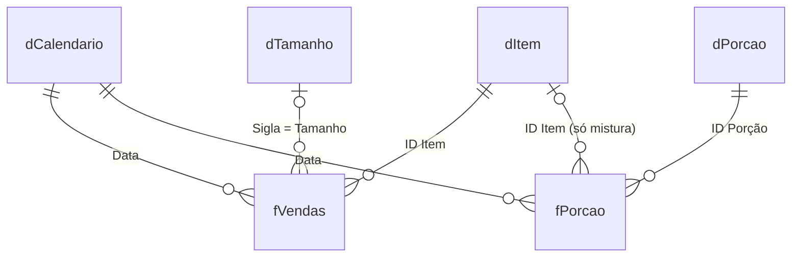

# JK Vendas: painel do Power BI

> **Versão de teste das porções** (pasta `jk_vendas_porcoes`, banco `jk_vendas_porcoes`). A sobra deixou de ser por prato e passou a ser por **porção em kg**: veja `MUDANCAS_PORCOES.md` na raiz.

O painel lê o banco MySQL `jk_vendas_porcoes`, onde o programa em Dart grava as vendas e as porções do dia. O caminho dos dados é **Excel → MySQL → Dart → MySQL → Power BI**. Quando o Dart grava uma venda nova, basta clicar em **Atualizar** no Power BI para ela aparecer nos gráficos.

| Arquivo | O que é |
| --- | --- |
| `JK_Vendas.pbip` | Abre o projeto no Power BI Desktop (duplo clique). |
| `JK_Vendas.SemanticModel/` | O modelo: as consultas do Power Query, as relações e as medidas DAX, em arquivos de texto (TMDL). |
| `JK_Vendas.Report/` | O relatório: 4 páginas, 9 tipos de visual, botões de navegação com ícones próprios e o tema do JK. |
| `.gitignore` | Deixa de fora do GitHub o cache local do Power BI. |

**Por que `.pbip` e não `.pbix`?** O `.pbix` é um arquivo fechado (zip). O `.pbip` guarda tudo em texto, então o GitHub mostra o que mudou em cada commit, como pede a rastreabilidade da orientação. Para entregar um arquivo único, use **Arquivo > Salvar como > .pbix**.

## Como abrir e ligar no MySQL

1. Rode no Workbench, na ordem: `sql/jk_vendas.sql` e `sql/carga_dados.sql`.
2. (Recomendado) Crie um usuário só de leitura para o Power BI, trocando a senha:

   ```sql
   CREATE USER 'jk_bi'@'localhost' IDENTIFIED BY 'troque_esta_senha';
   GRANT SELECT ON jk_vendas_porcoes.* TO 'jk_bi'@'localhost';
   ```

   O Power BI só lê. Com esse usuário, ele não consegue mudar nem apagar nada no banco.
3. Abra `JK_Vendas.pbip`.
4. Se o MySQL não estiver em `localhost` na porta 3306: **Página Inicial > Transformar dados > Editar parâmetros** e mude `Servidor` (exemplo: `localhost:3307`). O parâmetro `Banco` já vem `jk_vendas`.
5. Clique em **Atualizar**. Na janela de credenciais, escolha **Banco de dados** e entre com `jk_bi` (ou `root`) e a senha. A senha fica guardada no Power BI do computador, **não vai para o arquivo nem para o GitHub**.
6. Salve com Ctrl+S.

Se aparecer o aviso "Um ou mais objetos calculados precisam ser atualizados", é só clicar em **Atualizar agora**: o calendário é calculado depois que as vendas chegam.

O Power BI precisa do **MySQL Connector/NET** instalado. Nesta máquina ele já está (versão 26.10).

## Modelo estrela



| Tabela | Tipo | De onde vem | Linhas (carga simulada) |
| --- | --- | --- | ---: |
| `fVendas` | fato | visão `vw_fvendas` | 840 |
| `fPorcao` | fato | visão `vw_fporcao` (kg por porção e dia) | 122 |
| `dPorcao` | dimensão | visão `vw_dporcao` | 41 |
| `dItem` | dimensão | visão `vw_ditem` | 57 |
| `dTamanho` | dimensão | tabela `tamanho_marmita` | 6 |
| `dCalendario` | dimensão | DAX, do primeiro ao último dia com venda ou porção | 14 |
| `fAlteracao` | auditoria (sem relação) | tabela `registro_alteracao` | 136 |
| `_Medidas` | só guarda as medidas | DAX | 1 |

As relações vão sempre da dimensão para o fato (filtro em uma direção só). A `dCalendario` está marcada como tabela de datas, e as colunas de data dos fatos ficam ocultas: o filtro de data sempre passa pelo calendário. A `fAlteracao` não tem relação porque as alterações aconteceram no dia da carga, e não nos dias das vendas.

## Tratamento no Power Query

Cada consulta tem comentários explicando os passos. Em resumo:

- **Parâmetros `Servidor` e `Banco`:** trocar de computador não exige mexer nas consultas.
- **`fVendas`:** a hora (tipo TIME do MySQL) vira `Hora do Dia` e `Período` (Almoço antes das 17h, Noite depois); os nomes ficam em português; o valor é Moeda (decimal fixo).
- **`dItem`:** cria as colunas que ligam o banco à POO do Dart (veja abaixo); `confirmar` (0/1) vira "A confirmar (teste)" ou "Confirmado"; `Ordem Tipo` serve para o tipo aparecer na ordem prato do dia, fitness, executivo, bebida.
- **`dTamanho`:** P, M e G têm o preço da marmita (já em reais); PFE (prato feito executivo), PFF (prato feito fitness) e B (bebida) ficam sem preço, porque vale o do item. A coluna oculta `Ordem` deixa os tamanhos na ordem P, M, G, PFE, PFF, B.
- **`fAlteracao`:** o nome técnico da coluna alterada vira texto (`preco` → "Preço").

## Como a POO do Dart aparece no Power BI

O Power BI não roda o Dart, mas usa **as mesmas regras**, com o mesmo nome e o mesmo limite. Assim o resultado do menu "2 - vendas do dia" do Dart bate com o painel filtrado naquele dia.

| No Dart | No Power BI |
| --- | --- |
| Herança: `ItemVendavel` → `PratoDia`; `ItemPrecoFixo` → `PratoFitness`, `PratoExecutivo`, `Bebida` | Colunas `Classe POO (Dart)` e `Classe Mãe (Dart)` em `dItem`; treemap "Receita por classe POO" |
| Polimorfismo: `calcularPreco` (marmita pelo tamanho; os outros, preço fixo) | Coluna `Regra de Preço`; pizza "Marmitas por tamanho" |
| `ItemPrecoFixo.precoAConfirmar` | `Status do Preço`, `Itens a Confirmar`, `% Receita com Preço a Confirmar` |
| `ResumoVendas.totalPedidos` (usa um `Set`) | `Total de Pedidos` (usa `DISTINCTCOUNT`) |
| `ResumoVendas.receitaCentavos` e `ticketMedioCentavos` | `Receita Total` e `Ticket Médio` |
| `ResumoVendas.marmitasPorTamanho` | `Marmitas Vendidas` por `dTamanho[Tamanho]` |
| `ResumoVendas.itemMaisVendido` → "Feijoada completa (12)" | `Item Mais Vendido`, no mesmo formato |
| `PorcaoDia.desperdicioDoDia` e `SobraGuardada` (validade de 5 dias) | `Kg Desperdiçado` e `% Desperdício` |
| `PorcaoDia.limiteSobraAlta = 20.0` | `Limite Sobra Alta` = 20% |
| `PorcaoDia.alerta` | `Alerta de Sobra`, com os mesmos textos |

## Medidas DAX

São 40 medidas na tabela `_Medidas`, em 5 pastas. A descrição de cada uma aparece ao passar o mouse sobre ela no painel Dados. As seis pedidas no guia estão em **negrito**.

| Pasta | Medida | Como calcula | Valor com a carga simulada |
| --- | --- | --- | ---: |
| 1. Vendas | **Receita Total** | `SUM(fVendas[Valor Total])` | R$ 16.715,00 |
| | **Qtd Vendida** | `SUM(fVendas[Quantidade])` | 963 |
| | **Total de Pedidos** | `DISTINCTCOUNT(fVendas[ID Pedido])` | 400 |
| | **Ticket Médio** | `DIVIDE(Receita, Pedidos)` | R$ 41,79 |
| | Itens por Pedido | `DIVIDE(Qtd, Pedidos)` | 2,41 |
| | Maior Pedido / Menor Pedido | `MAXX` / `MINX` da receita de cada pedido | R$ 133,00 / R$ 4,00 |
| | Média de Receita por Dia | `AVERAGEX` sobre os dias | R$ 1.193,93 |
| | Receita Acumulada | soma do primeiro dia selecionado até o dia atual | R$ 16.715,00 no último dia |
| | Receita Dia Anterior | `DATEADD(..., -1, DAY)` | |
| | Variação vs Dia Anterior % | (hoje - ontem) / ontem | +47,0% no sáb 17/10 |
| | % da Receita | receita / receita de tudo o que está no visual (`ALLSELECTED`) | |
| 2. Pagamento e Local | % Pedidos Delivery | pedidos com local Delivery / pedidos | 37,0% |
| | Receita Fiado (a receber) | receita com pagamento Fiado | R$ 1.666,00 |
| | % Fiado | fiado / receita | 10,0% |
| 3. Itens e POO | Marmitas Vendidas | Qtd só do tipo prato do dia | 346 (P 69, M 143, G 134) |
| | Receita Marmitas | receita só do prato do dia | R$ 8.568,00 |
| | Preço Médio da Marmita | receita das marmitas / marmitas | R$ 24,76 |
| | **Ranking de Itens** | `RANKX` pela Qtd Vendida | 1º Filé de frango empanado |
| | Top 10 Itens (Qtd) | Qtd só de quem está até o 10º lugar | 11 itens (empate no 9º) |
| | Item Mais Vendido | `TOPN(1, ...)` | Filé de frango empanado (66) |
| | Itens no Catálogo | `COUNTROWS(dItem)` | 57 |
| | Itens a Confirmar | itens com valor de teste | 33 |
| | % Receita com Preço a Confirmar | quanto da receita usa preço de teste | 34,9% |
| | Dias no Cardápio | dias diferentes na `fPorcao` | Feijoada: 5 |
| | Marmitas por Dia no Cardápio | marmitas / dias no cardápio | Feijoada: 9,2 |
| 4. Porções (ODS 12) | Limite Sobra Alta | constante 20% | 20% |
| | Kg Preparado | `SUM(fPorcao[Kg Preparado])` | 229,25 kg |
| | Kg Reaproveitado | sobra de arroz e feijão usada (até 5 dias) | 20,33 kg |
| | Kg Sobra | `SUM(fPorcao[Kg Sobra])` | 46,16 kg |
| | Kg Desperdiçado | sobra de mistura e acompanhamento + arroz/feijão vencido | 25,83 kg |
| | **% Desperdício** | `DIVIDE(Desperdiçado, Preparado + Reaproveitado)` | 10,3% |
| | % Aproveitamento | 1 - % Desperdício | 89,7% |
| | Porções Vendidas (cardápio) | vendas de cada prato no dia em que estava no cardápio | 346 |
| | Porções com Sobra Alta | porções-dia (não reaproveitáveis) com sobra acima de 20% | 57 |
| | Alerta de Sobra | `SWITCH` com os textos do Dart | "ALERTA: sobrou ..." nas parmegianas |
| | Escala do Gauge | 2 × limite (fim do velocímetro) | 40% |
| 5. Rastreabilidade | Qtd Alterações | `COUNTROWS(fAlteracao)` | 136 |
| | Última Alteração | `MAX(fAlteracao[Alterado Em])` | data e hora da carga |

Os números foram conferidos com as consultas de `sql/consultas_conferencia.sql`: receita por dia (consulta 3), tamanhos (4), ticket por local (7), porções por tipo (9) e reaproveitado = usado da geladeira (10).

## Páginas

| Página | Segmentações | Visuais |
| --- | --- | --- |
| Visão Geral | Data, Categoria, Local | 5 cartões; colunas + linha (receita e pedidos por dia); rosca (pagamento); linha (pedidos por hora); colunas (ticket por local); colunas (receita média por dia da semana) |
| Menu (Itens e POO) | Data, Categoria, Local | 5 cartões; barras (Top 10); treemap (classes POO); pizza (marmitas por tamanho); tabela (ranking e classe) |
| Porções (ODS 12) | Data, Tipo de porção | 5 cartões (kg preparado, kg desperdiçado, % desperdício, porções com sobra alta, kg reaproveitado); velocímetro (% desperdício × limite); colunas (% desperdício por porção); linha (% desperdício por dia); tabela (alerta por porção) |
| Rastreabilidade | (nenhuma) | 4 cartões; barras (alterações por tipo); tabela (histórico da auditoria) |

Tipos de visual usados: cartão, segmentação, gráfico de colunas e linhas, rosca, linha, colunas, barras, treemap, pizza, velocímetro e tabela.

### Botões de navegação

Toda página tem uma barra à esquerda com o logo do JK e um botão por tela. O botão da tela atual fica vermelho, e os outros, brancos. Todo botão leva para a sua página (o da tela atual também), e o logo volta para a Visão Geral.

| Botão | Imagem | Por quê |
| --- | --- | --- |
| Visão Geral | colunas subindo com a seta de tendência | é o painel com o resumo das vendas |
| Menu | prato com tampa (cloche) | mostra o que o restaurante vende e a classe de cada item |
| Sobras | tigela com folhas | comida que sobra e consumo responsável |
| Auditoria | prancheta com relógio | histórico de quem mudou o quê, e quando |

- Os ícones são imagens SVG desenhadas para o projeto, em `JK_Vendas.Report/StaticResources/RegisteredResources/nav_*.svg`. Cada tela tem duas versões: `_ativo` (vermelho) e normal (branco).
- No Power BI, cada botão é um visual de **Imagem** com **Ação > Tipo: Navegação de página**.
- **Para clicar:** no Power BI Desktop, enquanto edita, segure **Ctrl** e clique. No modo de leitura e no Power BI Service, é só clicar.

## Teste de ponta a ponta (passo 7)

1. Anote no Power BI a Receita Total e o Total de Pedidos.
2. No Dart (`dart run`), opção 1, faça um pedido. Exemplo: 1 marmita G de feijoada + 1 Coca-Cola lata.
3. No Power BI, clique em **Atualizar**: a receita sobe R$ 33,00 e os pedidos sobem 1. O dia de hoje aparece sozinho no calendário.
4. No Dart, opção 3, registre as porções do dia (kg). Ao atualizar, a página Porções muda e a página Rastreabilidade mostra a alteração com o usuário do MySQL.

## Perguntas que o professor pode fazer

- **Por que `DISTINCTCOUNT` nos pedidos?** A `fVendas` tem uma linha por item. Um pedido com 3 itens aparece 3 vezes. No Dart, o mesmo problema foi resolvido com um `Set`.
- **Por que uma tabela calendário?** Para filtrar por data, dia da semana e mês em todos os fatos ao mesmo tempo, e para as funções de tempo (`DATEADD`) funcionarem.
- **Por que `DIVIDE` e não `/`?** O `DIVIDE` devolve vazio quando o divisor é zero, em vez de dar erro.
- **Por que as medidas ficam numa tabela separada?** Para organizar em pastas e não misturar medida com coluna. O modelo também desliga as somas automáticas: todo número do painel vem de uma medida explicada aqui.
- **Por que `KEEPFILTERS`?** Para a medida respeitar o filtro que já existe. Por exemplo, "Marmitas Vendidas" com o filtro Categoria = Bebida dá vazio, e não o total de marmitas.
- **Como o Power BI sabe a classe do Dart?** Pelo `tipo` gravado no banco. Cada classe filha devolve o seu tipo no getter `tipo` (PRATO_DIA, FITNESS...), e o Power Query traduz esse tipo para o nome da classe.

## Evolução final (atividade de 10/11/2026)

- **Template de fundo:** cada página usa como plano de fundo a imagem do template feito no PowerPoint (`StaticResources/RegisteredResources/fundo_<página>.png`).
- **Hierarquias no modelo:** Calendário (ano › mês › dia), Cardápio (classe mãe › classe POO › item) e Porções (tipo › porção).
- **Drill-down:** "% de desperdício por tipo de porção" (página Porções: tipo › porção) e "Receita média por dia da semana" (Visão Geral: dia da semana › data).
- **Mapas:** não usados, porque os pedidos não têm endereço (só balcão, viagem ou delivery) e há um restaurante só.
